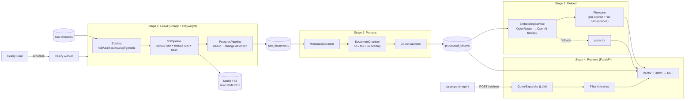

# Singapore Property Knowledge Base (KB-Pipeline)

A data pipeline that turns Singapore government property regulations into a searchable knowledge base for a property-advisory AI agent (RAG: Retrieval-Augmented Generation).

The pipeline crawls five official sources, extracts and cleans the text, splits it into chunks, generates embeddings, and serves hybrid (vector + keyword) search through a FastAPI `/retrieve` endpoint.

| Code | Source | What we extract |
|---|---|---|
| `hdb` | Housing & Development Board (hdb.gov.sg) | Flat eligibility, grants, BTO/resale rules |
| `ura` | Urban Redevelopment Authority (ura.gov.sg) | Private property and development guidelines |
| `iras` | Inland Revenue Authority (iras.gov.sg) | Stamp duties (BSD/ABSD/SSD), property tax |
| `mas` | Monetary Authority of Singapore (mas.gov.sg) | LTV limits, TDSR/MSR, mortgage rules |
| `cpf` | CPF Board (cpf.gov.sg) | CPF housing usage, withdrawal limits |

> **Consumer:** the `sg-property-agent` app (LangGraph backend, React frontend, WhatsApp channel; it lives on other branches, see [Branches](#7-branches-what-lives-where)) calls `POST /retrieve` on this service through its `retrieve_property_info` tool.

---

## Contents

1. [Architecture](#1-architecture)
2. [Libraries and why each is used](#2-libraries-and-why-each-is-used)
3. [Repository layout](#3-repository-layout)
4. [Getting started](#4-getting-started)
5. [Code flow, step by step](#5-code-flow-step-by-step)
6. [Data model and storage layout](#6-data-model-and-storage-layout)
7. [Branches: what lives where](#7-branches-what-lives-where)
8. [Known issues](#8-known-issues)
9. [Verification plan (are the results correct?)](#9-verification-plan-are-the-results-correct)
10. [Next steps and the libraries each one needs](#10-next-steps-and-the-libraries-each-one-needs)

---

## 1. Architecture



Every stage reads its input from PostgreSQL and writes its output back with a status flag, so stages can run together or on their own:

```
raw_documents.status:  pending ──(process)──▶ processed      (or failed / deleted)
processed_chunks.embedding_id:  NULL ──(embed)──▶ <vector id>
```

---

## 2. Libraries and why each is used

All runtime dependencies are declared in [pyproject.toml](pyproject.toml).

### Crawling

| Library | Used in | Purpose |
|---|---|---|
| **Scrapy** ≥2.11 | [crawlers/](crawlers/) | Crawl engine: scheduling, link following, robots.txt, retry with backoff, download delay, item pipelines, crawl stats |
| **scrapy-playwright** / **Playwright** | [crawlers/scrapy_settings.py](crawlers/scrapy_settings.py), [crawlers/base.py](crawlers/base.py) | Headless Chromium for JavaScript-rendered pages (HDB, CPF). Turned on per source with `js_rendering: true` |
| **Twisted** (asyncio reactor, installed with Scrapy) | `TWISTED_REACTOR` setting | Event loop that Scrapy runs on. The asyncio reactor is required by Playwright |

### Extraction and processing

| Library | Used in | Purpose |
|---|---|---|
| **BeautifulSoup4** + **lxml** | [processors/html_extractor.py](processors/html_extractor.py), [crawlers/base.py](crawlers/base.py) | Parse HTML, remove noise (nav/footer/cookie banners), pick the main content node via `content_selectors`, collect the h1–h6 heading hierarchy |
| **pdfplumber** | [processors/pdf_extractor.py](processors/pdf_extractor.py), [processors/table_extractor.py](processors/table_extractor.py) | Primary PDF text and table extraction |
| **PyMuPDF** (`fitz`) | [processors/pdf_extractor.py](processors/pdf_extractor.py) | Fallback PDF text extraction, plus scanned-PDF detection (image coverage and text density per page) |
| **langchain-text-splitters** | [processors/chunker.py](processors/chunker.py) | `RecursiveCharacterTextSplitter`: splits on paragraph, then line, then word |
| **tiktoken** (`cl100k_base`) | chunker, validator, embedder | Counts tokens with the same tokenizer as the OpenAI embedding model, so chunk sizes are exact |

### Embeddings, vector stores and retrieval

| Library | Used in | Purpose |
|---|---|---|
| **openai** SDK | [embedders/embedding_service.py](embedders/embedding_service.py), [api/query_expander.py](api/query_expander.py) | Calls `text-embedding-3-large` (3072 dims) through **OpenRouter** first (OpenAI-compatible), falling back to OpenAI directly. Also used for the query-expansion chat call (`openrouter_chat_model`, default `openai/gpt-4o-mini`) |
| **pinecone** | [embedders/pinecone_store.py](embedders/pinecone_store.py) | Primary vector index (cosine). Each vector is written to a per-source namespace and to the shared `all` namespace |
| **pgvector** (+ `pgvector/pgvector:pg16` image) | [embedders/pgvector_store.py](embedders/pgvector_store.py) | Fallback vector store inside PostgreSQL (`processed_chunks.embedding vector(3072)`) |
| **rank-bm25** | [embedders/bm25_store.py](embedders/bm25_store.py) | In-memory BM25Okapi keyword index, fused with vector results by Reciprocal Rank Fusion |
| **tenacity** | embedding service, vector stores | Retry with exponential backoff for external API calls |

### Storage, API, scheduling, utilities

| Library | Used in | Purpose |
|---|---|---|
| **SQLAlchemy 2** + **psycopg2-binary** | [config/database.py](config/database.py), [config/models.py](config/models.py) | ORM and PostgreSQL driver |
| **Alembic** | [alembic/versions/](alembic/versions/) | Schema migrations. Migration 001 also seeds the 5 sources |
| **boto3** | [config/storage.py](config/storage.py) | S3 client for MinIO (locally) or AWS S3: raw HTML/PDF and embedding archives |
| **FastAPI** + **uvicorn** | [api/](api/) | Retrieval API (`/health`, `/retrieve`) |
| **Celery[redis]** + **Redis** | [config/celery_app.py](config/celery_app.py), [tasks/](tasks/) | Celery Beat triggers scheduled crawls; the worker runs the pipeline. Redis is the broker and result backend |
| **pydantic** / **pydantic-settings** | [config/settings.py](config/settings.py), [api/schemas.py](api/schemas.py) | Typed settings from `.env`; API request/response validation |
| **structlog** | [config/logger.py](config/logger.py) | Structured JSON logs with per-run context (`run_id`, `source`, `url`) |
| **httpx** | [config/notifications.py](config/notifications.py) | Slack webhook on final crawl-task failure |
| **PyYAML** | [config/celery_app.py](config/celery_app.py), [config/sync_sources.py](config/sync_sources.py) | Reads [config/sources.yml](config/sources.yml) (source definitions and cron schedules) |
| **python-dotenv** | settings | `.env` loading |

### Development

| Tool | Purpose |
|---|---|
| **pytest**, **pytest-cov**, **pytest-asyncio** | Unit tests. Coverage gate is 80% (`--cov-fail-under=80`) |
| **ruff**, **black**, **mypy** | Lint, format and type checks (line length 100) |
| **GitHub Actions** | [.github/workflows/ci.yml](.github/workflows/ci.yml): ruff, black --check and unit tests on push/PR to `main`/`master` |
| **Docker Compose** | Runs the app, API, worker, beat, Postgres, Redis and MinIO |

---

## 3. Repository layout

```
run_pipeline.py            CLI entry point: crawl → process → embed (flags below)
clean_data.py              Wipes DB tables and MinIO prefixes (dev only!)
setup.sh                   One-command local setup (Docker, migrations, source sync)
config/
  settings.py              Pydantic settings (.env)
  database.py              SQLAlchemy engine + SessionLocal
  models.py                Source, RawDocument, ProcessedChunk, CrawlJob, TaskExecution
  sources.yml              Source definitions: URLs, selectors, tag_config, schedules
  sync_sources.py          Copies sources.yml → sources.crawl_config (JSONB)
  storage.py               S3/MinIO helpers
  celery_app.py            Celery app + Beat schedule built from sources.yml
  logger.py, notifications.py
crawlers/
  base.py                  BaseCrawler: DB-driven config, link filtering, Playwright meta
  spiders/{hdb,ura,iras,mas,cpf}.py   Thin subclasses (config lives in DB)
  spiders/generic.py       Crawls any active DB source without its own spider
  pipelines.py             S3Pipeline (upload + extract + hash), PostgresPipeline (dedup/change detection)
  runner.py                Starts spiders, records crawl_jobs + summary
processors/
  html_extractor.py, pdf_extractor.py, table_extractor.py
  metadata_extractor.py    title / section / effective_date / tags
  chunker.py               Token-based chunking + heading_path breadcrumbs
  validator.py             Chunk quality gate
  runner.py                process_pending_documents()
embedders/
  embedding_service.py     OpenRouter → OpenAI embeddings, batching, token logging
  pinecone_store.py, pgvector_store.py, bm25_store.py
  pipeline.py              embed_chunks(), cleanup_deleted_documents(), purge_vectors()
api/
  app.py                   FastAPI app
  retrieval.py             RetrievalService (vector / hybrid + RRF)
  query_expander.py        LLM phrasings + entity extraction
  metadata_filter_inference.py   Rule-based filter inference from the query
tasks/pipeline_tasks.py    Celery task wrapping run_full_pipeline()
alembic/                   Migrations 001–007
tests/unit, tests/integration
docs/                      Architecture deep-dives and the original task breakdown
```

---

## 4. Getting started

### Prerequisites
- Docker Desktop
- API keys: OpenRouter and/or OpenAI (embeddings), Pinecone (optional; pgvector is used without it)

### Setup

```bash
bash setup.sh
```

[setup.sh](setup.sh) does the following:
1. Copies `.env.example` to `.env`.
2. Runs `docker compose up -d --build`.
3. Waits until the services are healthy.
4. Runs `alembic upgrade head` (creates the schema and seeds the 5 sources).
5. Runs `python -m config.sync_sources` (copies [config/sources.yml](config/sources.yml) into `sources.crawl_config`).
6. Creates the MinIO bucket.

Add your keys to `.env` before crawling. All Python runs **inside** the `KB-Pipeline-App` container.

| Service | URL |
|---|---|
| Retrieval API | http://localhost:8000 (`/docs` for Swagger) |
| MinIO console | http://localhost:9001 (minioadmin / minioadmin) |
| PostgreSQL | localhost:5432 (kb_user / kb_pass, db `kb_pipeline_db`) |
| Redis | localhost:6379 |

### Running the pipeline

```bash
APP="docker exec KB-Pipeline-App"

$APP python run_pipeline.py                         # all stages, all sources
$APP python run_pipeline.py hdb iras                # only these sources
$APP python run_pipeline.py --crawl-only -S CLOSESPIDER_PAGECOUNT=10   # quick test crawl
$APP python run_pipeline.py --process-only          # chunk pending docs
$APP python run_pipeline.py --embed-only            # embed un-embedded chunks
$APP python run_pipeline.py --skip-embed            # crawl + process
$APP python run_pipeline.py --incremental           # job_type=incremental
$APP python run_pipeline.py hdb --purge-vectors     # DESTRUCTIVE: wipe Pinecone namespace(s)
```

### Querying

```bash
curl -X POST localhost:8000/retrieve -H 'Content-Type: application/json' -d '{
  "query": "What is the ABSD for a PR buying a second condo?",
  "top_k": 5,
  "search_mode": "hybrid",
  "filters": {"source": ["iras"]}
}'
```

### Tests and lint

```bash
$APP pytest                                   # unit tests, 80% coverage gate, skips "integration"
$APP pytest -m integration tests/integration  # live sites + infra
$APP ruff check . && $APP black --check .
```

### Configuration reference (`.env`)

| Variable | Purpose |
|---|---|
| `DATABASE_URL`, `REDIS_URL` | Postgres and Redis connections (use the service names `postgres`/`redis` inside Docker) |
| `S3_ENDPOINT`, `S3_ACCESS_KEY`, `S3_SECRET_KEY`, `S3_REGION`, `S3_BUCKET` | MinIO/S3 |
| `OPENROUTER_API_KEY`, `OPENROUTER_BASE_URL` | Primary provider for embeddings and query expansion |
| `OPENROUTER_CHAT_MODEL` | Query-expansion LLM (default `openai/gpt-4o-mini`) |
| `OPENAI_API_KEY` | Fallback embedding provider |
| `PINECONE_API_KEY`, `PINECONE_INDEX`, `PINECONE_ENVIRONMENT` | Vector index |
| `CRAWL_DELAY`, `CRAWL_USER_AGENT`, `CRAWL_RESPECT_ROBOTS_TXT`, `CRAWL_MAX_RETRIES` | Global crawl defaults (each source can override them in `sources.yml`) |
| `SLACK_WEBHOOK_URL` | Failure notifications (optional) |
| `CELERY_TIMEZONE` | Default `Asia/Singapore` |
| `LOG_LEVEL` | structlog level |

---

## 5. Code flow, step by step

Entry point: `run_full_pipeline()` in [run_pipeline.py](run_pipeline.py). It is called from the CLI or from the Celery task `run_source_pipeline_task` in [tasks/pipeline_tasks.py](tasks/pipeline_tasks.py).

### Step 0: Source configuration
1. [config/sources.yml](config/sources.yml) defines, for each source: `start_urls`, `allowed_domains`, `target_prefixes` / `skip_prefixes`, `blocked_subdomains`, `js_rendering`, `crawl_delay`, `content_selectors`, `content_keywords_filter`, `tag_config` (keyword → tag rules) and a `schedule` (cron).
2. [config/sync_sources.py](config/sync_sources.py) upserts this into `sources.crawl_config` (JSONB). **The crawlers read config only from the database**, not from the YAML file.
3. [config/celery_app.py](config/celery_app.py) builds the Celery Beat schedule from the YAML `schedule` keys. The default is a full crawl on Sunday at 02:00 SGT and an incremental crawl daily at 06:00 SGT.

### Stage 1: Crawl ([crawlers/runner.py](crawlers/runner.py) → `run_crawlers`)
1. For each source code, create a `crawl_jobs` row (`status=running`) and schedule its spider. When no source is given, the `generic` spider is scheduled too.
2. **Spider start** ([crawlers/base.py](crawlers/base.py) `BaseCrawler`):
   - Load `crawl_config` from the DB.
   - Apply `DOWNLOAD_DELAY`, `ROBOTSTXT_OBEY` and `USER_AGENT` from that config.
   - Yield requests for `start_urls`, adding Playwright meta when `js_rendering` is on.
3. **`handle_response` → `parse_document`**:
   - **PDF** (detected by URL or `Content-Type`): yield a `CrawlItem` with `raw_pdf`.
   - **HTML**: run a quick main-content extraction. Skip the page if it is shorter than `min_content_length` or fails `content_keywords_filter`. Otherwise yield a `CrawlItem` with `raw_html` and the source's `content_selectors`.
4. **`_follow_links`**: a link is followed only if all of these hold:
   - scheme is http/https;
   - not a static asset;
   - domain is in `allowed_domains` and not a blocked subdomain;
   - path is not in `skip_prefixes`, and is in `target_prefixes` when that list is set (PDFs always pass the path checks).
5. **`S3Pipeline`** ([crawlers/pipelines.py](crawlers/pipelines.py)):
   - Upload the raw file to `raw-html/` or `raw-pdf/{source}/{date}/{md5(url)[:12]}`.
   - Run the full `HTMLExtractor` or `PDFExtractor` (below).
   - Append tables as Markdown wrapped in `[TABLE_START]`/`[TABLE_END]`.
   - Set `raw_text` and `content_hash = sha256(normalised text)`.
   - Record `extraction_flags` (warnings, word count, table count, title, headings, `needs_ocr`, `used_fallback`).
6. **`PostgresPipeline`**:
   1. **Cross-URL duplicate**: if another URL already has the same hash, skip the item and delete its S3 object.
   2. **Change detection** by `(source_id, url)`:
      - new URL → insert with `status=pending`;
      - hash changed → update the row and reset to `pending`;
      - unchanged → bump `last_seen_at` only.
   3. **On close**: URLs in the DB but not seen in this crawl are marked `status=deleted`.
7. Spider stats (`pages_new`, `pages_changed`, `pages_deleted`, errors) are written back to `crawl_jobs`, and a summary table is printed.
8. **Post-crawl cleanup** (`EmbeddingPipeline.cleanup_deleted_documents`) deletes the vectors and chunks of `deleted` documents.

**Extractors**
- [HTMLExtractor](processors/html_extractor.py):
  - parses with BeautifulSoup and removes noise tags and classes;
  - picks the content node via `content_selectors`, then `main`/`article`/`role=main`, then `body`;
  - collects h1–h6 headings and tables (via `TableExtractor`), and normalises whitespace.
- [PDFExtractor](processors/pdf_extractor.py):
  - extracts text and tables with pdfplumber, falling back to PyMuPDF on error or empty text;
  - detects scanned PDFs (few words per page, large image coverage), which sets `needs_ocr`.

### Stage 2: Process ([processors/runner.py](processors/runner.py) → `process_pending_documents`)
For each `raw_documents` row with `status=pending`:
1. Rebuild an `ExtractedDocument` from `raw_text` and `extraction_flags` (title, headings). No re-download is needed.
2. **[MetadataExtractor](processors/metadata_extractor.py)** produces `title`, `source_agency`, `section` (first heading), `effective_date` (regex date patterns → ISO) and `tags` (`property_type`, `citizenship`, `topic`, matched with the source's `tag_config`).
3. **[DocumentChunker](processors/chunker.py)** uses `RecursiveCharacterTextSplitter.from_tiktoken_encoder(chunk_size=512, chunk_overlap=64, separators=["\n\n", "\n", " "])`. Each chunk gets:
   - the document metadata plus `chunk_index` and `chunk_type`;
   - a `heading_path` breadcrumb, computed from the chunk's offset in the text;
   - an exact tiktoken count.
4. **[ChunkValidator](processors/validator.py)** applies two levels of checks:
   - **Errors (the chunk is dropped):** empty text, NUL bytes, invalid `chunk_type`, fewer than 50 or more than 600 tokens, boilerplate-only, duplicate within the document (SHA-256).
   - **Warnings (logged, chunk kept):** word-count mismatch, missing URL/source/metadata keys, malformed `heading_path`, possible mid-sentence split.
   - Surviving chunks are re-indexed from 0.
5. Delete the document's old chunks, insert the new `processed_chunks` rows, and set the document to `status=processed`. On an exception the status becomes `failed` and the traceback goes into `error_message`.

### Stage 3: Embed ([embedders/pipeline.py](embedders/pipeline.py) → `EmbeddingPipeline.embed_chunks`)
1. Select chunks with `embedding_id IS NULL` whose document is not `deleted`. Re-processed documents get fresh chunks, so only new or changed content is embedded.
2. **[EmbeddingService](embedders/embedding_service.py)**:
   - batches at most 2048 texts and 250k tokens per call;
   - calls OpenRouter with tenacity retries, switching to OpenAI for the rest of the run if OpenRouter keeps failing;
   - logs token usage per batch for cost tracking.
3. **Upsert**:
   - Pinecone, into namespaces `{source}` and `all`, with metadata `source_name`, `property_types` and `citizenship_types`;
   - pgvector **only if Pinecone is unavailable or fails** (see [Known issues](#8-known-issues)).
4. Archive each embedding as JSON to S3 at `processed/embeddings/{date}/{vector_id}.json`.
5. Write `processed_chunks.embedding_id`.

### Stage 4: Retrieve ([api/retrieval.py](api/retrieval.py) → `RetrievalService.retrieve`)
1. **Startup** ([api/dependencies.py](api/dependencies.py)) creates the embedding service, Pinecone, pgvector, the BM25 index (built once from all embedded chunks) and the query expander. Each one degrades gracefully if unavailable.
2. **Query expansion** ([api/query_expander.py](api/query_expander.py)):
   - expands abbreviations (ABSD, BSD, SSD, TDSR, MSR, LTV, EC, BTO, OA/SA, SC/PR, …);
   - asks the LLM for 2 alternative phrasings plus `property_type`, `citizenship` and `topic` entities;
   - falls back to `[query]` if the LLM call fails.
3. **Filter inference** ([api/metadata_filter_inference.py](api/metadata_filter_inference.py)): regex rules map words such as "HDB", "condo", "PR" or "IRAS" to `source`, `property_type` and `citizenship_type` filters. These are merged (as a union) with the LLM entities and the user-supplied filters.
4. **For each phrasing**: embed it, then search.
   - `vector` mode: Pinecone, using one source's namespace when a single source is filtered, otherwise `all` with a `$in` filter. Falls back to pgvector.
   - `hybrid` mode (the default): take the top `5×top_k` from vector search and from BM25 (filtered the same way), fuse them with **Reciprocal Rank Fusion** `1/(60+rank_v) + 1/(60+rank_bm25)`, then load the chunk text and metadata from Postgres.
5. De-duplicate across phrasings by `(source_url, chunk_index)`, keeping the highest score, and return the top `top_k`.
6. The response includes `inferred_filters`, `applied_filters`, a timing `trace` and `store_used`.

---

## 6. Data model and storage layout

| Table | Key columns |
|---|---|
| `sources` | `code` (hdb/ura/iras/mas/cpf), `name`, `base_url`, `crawl_config` JSONB (GIN index), `is_active` |
| `raw_documents` | `source_id`, `url` (unique per source), `content_hash`, `content_type`, `raw_text`, `s3_path`, `status` (pending/processed/failed/deleted), `needs_ocr`, `extraction_flags`, `last_seen_at` |
| `processed_chunks` | `document_id` (cascade delete), `chunk_text`, `chunk_index`, `token_count`, `embedding_id`, `embedding vector(3072)`, `metadata_json` |
| `crawl_jobs` | per-source crawl run: `job_type`, `status`, `pages_found/new/changed/deleted/errored` |
| `task_executions` | Celery task history (migration 007). The table exists, but nothing writes to it yet on `dev` ([Next steps](#10-next-steps-and-the-libraries-each-one-needs)) |

MinIO bucket `sg-property-kb`:
```
raw-html/{source}/{YYYY-MM-DD}/{url_hash}.html
raw-pdf/{source}/{YYYY-MM-DD}/{url_hash}.pdf
processed/{source}/{YYYY-MM-DD}/{url_hash}.txt
processed/embeddings/{YYYY-MM-DD}/{vector_id}.json
```

---

## 7. Branches: what lives where

Reviewed on 2026-11-22. `dev` is the most complete branch for the KB pipeline itself, and `origin/master` is an ancestor of it.

| Branch | Contents | Status relative to `dev` |
|---|---|---|
| `dev` | This pipeline (crawl → process → embed → retrieve, scheduling) | Baseline |
| `master` | Older snapshot | Fully contained in `dev` |
| `features` | Improved HTML/PDF extraction: tables placed **inline at their document position** instead of appended; PDF reading order rebuilt from word coordinates | **Not merged** (conflicts with `dev`'s `pdf_extractor.py`). It also assumes tables are *not* appended again by `crawlers/pipelines.py::_merge_tables_into_text`, so a naive merge would duplicate every table. Planned as a next step |
| `property-advisory-ai-advisory` | Monorepo (unrelated history): `KB-Pipeline/` (a later copy of this code), `sg-property-agent/` (incl. an MCP server), `testing/` (QA plan, metrics, datasets, DeepEval RAG evaluation, agent routing tests) | Partially ported (below) |
| `sg-property-agent` | Downstream chat agent: LangGraph + FastAPI backend, React frontend, WhatsApp channel, stamp-duty calculator | Separate application; intentionally **not** merged into this repo |

### Ported into `dev` from `property-advisory-ai-advisory/KB-Pipeline`

| Change | Why it was needed |
|---|---|
| `from sqlalchemy import func` in [crawlers/pipelines.py](crawlers/pipelines.py) | `func.now()` was used without an import. Every re-crawl of an **unchanged** page raised `NameError`, so the item was dropped and `last_seen_at` never updated |
| `content_selectors` passed spider → `CrawlItem` → `HTMLExtractor.extract()` | The per-source selectors in `sources.yml` were ignored by the real extractor, which always fell back to generic `main`/`article`/`body` |
| `open_spider(self, spider=None)` / `close_spider(self, spider=None)` | Scrapy versions allowed by `scrapy>=2.11` pass `spider` positionally, and the no-argument signature raises `TypeError` there. Now works with and without the argument |
| Migration [007_add_task_executions.py](alembic/versions/007_add_task_executions.py) + `TaskExecution` model | `dev` had **two Alembic heads** (`006` and `9d14d2974166` both revise `005`), so `alembic upgrade head` in `setup.sh` failed. 007 is the merge revision with the same id as the monorepo, so databases from both branches stay compatible |
| `clean_data.py` also clears `task_executions` | Keeps the reset script in sync with the schema |

Fixed on `dev` (missing from all branches): `GenericSpider` called the removed Scrapy API `make_requests_from_url(url, meta=...)` and lost the source config on followed links. It now yields `scrapy.Request(...)` and propagates `source_code`/`crawl_config` in `meta`.

### Not ported (yet), and why

| Item (location in `property-advisory-ai-advisory`) | Reason |
|---|---|
| API endpoints `/crawl`, `/process`, `/embed`, `/jobs`, `/config` + Celery tasks that write `task_executions` (`KB-Pipeline/api/app.py`, `api/schemas.py`, `tasks/pipeline_tasks.py`) | Useful (covers the planned monitoring endpoint, task 3.7). Larger change that needs integration testing against the running stack; next step #1 |
| DB-driven schedule, removal of `sources.yml`/`sync_sources.py`, source config seeded inside migration 001 | Editing an already-applied migration doesn't update existing databases. Should be a new migration (next step #6) |
| CrawlerRunner + manual reactor in `crawlers/runner.py` | Fixes "ReactorNotRestartable" when Celery runs several crawls in one worker process. Needs testing with Celery; next step #2 |
| Grafana dashboard (`KB-Pipeline/grafana/`) | Queries tables that don't exist (`crawl_runs`, `embedding_stats`) and has no compose service. Rebuild against the real schema (next step #4) |
| Verbose `logger.info` additions (spiders, retrieval) | Noise at INFO level. Better as DEBUG, or as metrics |
| `tests/unit/test_chunker.py`, expanded `test_base_spider.py` | The chunker file is mostly commented-out code with a personal local path; the spider tests target the monorepo's spider API |
| `ingest_offline_docs.py`, `testing/` folder | Evaluation tooling. Adopt together with the verification plan (§9) |
| `config/settings.py` | **Do not port**: it contains a typo regression `redis://l ocalhost:6379/0` |

---

## 8. Known issues

| # | Issue | Impact |
|---|---|---|
| 1 | **Tables are duplicated in `raw_text`.** `HTMLExtractor` uses `get_text()` (which includes table cells), and `_merge_tables_into_text` then appends the same tables as Markdown | Duplicate content in chunks; tables are cut away from their context |
| 2 | Stage 2 sets `tables=[]`, so no `chunk_type="table"` chunks are produced; tables are split by the text splitter | Large tables (rate schedules) can be split across chunks |
| 3 | **pgvector is not dual-written.** It is only populated when Pinecone fails, so the pgvector fallback at query time is usually empty | "Backup" store is not a real backup |
| 4 | No vector index on `processed_chunks.embedding`. pgvector's HNSW/IVFFlat support `vector` up to 2000 dims, but we store 3072 | pgvector search is a sequential scan |
| 5 | The BM25 index is built once at API startup | Newly embedded chunks are invisible to keyword search until the API restarts |
| 6 | The Pinecone filter supports only `source_name`, `property_types` and `citizenship_types`; `topic` and `effective_date` are not in vector metadata | Topic/date filters are impossible |
| 7 | Hybrid search runs BM25 on each phrasing. The final cross-phrasing sort compares RRF scores, which carry no absolute meaning | `score` is not comparable across requests; no relevance threshold possible |
| 8 | Housekeeping: `processors/__init__ copy.py` (duplicate), committed `celerybeat-schedule*` runtime files, stale [CLAUDE.md](CLAUDE.md) (still says httpx and "Week 2 not started") | Confusion |
| 9 | CI triggers only on `main`/`master`, not `dev` | PRs into `dev` are unchecked |
| 10 | No answer-level citation check: chunks carry `source_url`, but nothing verifies that the agent's answer is supported by them | Hallucination risk downstream |

---

## 9. Verification plan (are the results correct?)

Goal: each layer is measured against a **ground truth**, with a target and a command that produces the number. Targets come from the team's QA plan (`testing/QA_METRICS.md` on `property-advisory-ai-advisory`) and the original task breakdown ([docs/task-breakdown.md](docs/task-breakdown.md)). Targets marked *(proposed)* are new suggestions; agree on them as a team.

### 9.1 Ground-truth datasets to build or adopt

| Dataset | Content | Where it comes from |
|---|---|---|
| **Expected URL list** per source | Pages that must be crawled | Manual list; `estimated_pages` in `sources.yml` as a sanity bound |
| **Extraction gold set** | ~20 HTML pages and ~10 PDFs with hand-verified clean text and tables | `testing/datasets/{html,pdfs}` and `testing/evaluation/eval_docs/{hdb,ura,iras,mas,cpf}` (offline snapshots, so tests don't depend on live sites) |
| **Retrieval Q&A set** | Question → expected source URL(s) → expected answer. Minimum 50: HDB eligibility 10, stamp duty 10, CPF 8, MAS 8, URA 7, cross-source 7 | Start from `testing/evaluation/testset.csv` (it already has `Question, Answer, Source URL`) and extend; `generate_synthetic_testset.py` can draft more, but **a human must verify every row** |
| **Edge-case set** | Abbreviation-heavy ("ABSD for PR 2nd property"), ambiguous, multi-source, Mandarin, out-of-scope | Task 3.10 |
| **Numeric facts set** | Rates and limits that must be exact (ABSD %, LTV %, BSD tiers, CPF limits), each with its official source URL | Hand-built; re-verify after every policy change |

### 9.2 Metrics, targets and how to measure

| Layer | Metric | Target | How to measure |
|---|---|---|---|
| Crawl | Recall vs expected URL list | > 95% | `SELECT url FROM raw_documents JOIN sources … WHERE code='hdb'` compared with the list |
| Crawl | Change detection rate / false-positive rate | > 98% / < 2% | Serve a page fixture twice (unchanged → expect `pages_unchanged`), modify it → expect `pages_changed` and `status=pending`. Unit-testable with mocked DB |
| Crawl | Error rate | < 1% | `crawl_jobs.pages_errored / pages_found` |
| Extraction | HTML parse success | > 99% | `extraction_flags->>'is_empty'` = false ratio |
| Extraction | Content precision (no nav/boilerplate) | > 90% | Gold-set comparison: share of extracted lines present in gold text |
| Extraction | PDF CER / WER | < 2% / < 5% | `jiwer` against gold text |
| Extraction | Table accuracy | > 90% | Cell-level exact match against gold tables |
| Processing | Metadata completeness | > 95% | % of chunks with non-empty `title`, `section`, `source_agency`, and ≥1 tag |
| Processing | Tag accuracy | > 90% *(proposed)* | Hand-labelled sample of 100 chunks (property_type / citizenship / topic) |
| Processing | Chunk size compliance | 100% in [50, 600] tokens | `SELECT … WHERE token_count NOT BETWEEN 50 AND 600` must be 0 |
| Processing | Duplicate rate | < 2% | `SELECT md5(chunk_text), count(*) … HAVING count(*)>1` |
| Embedding | Coverage | 100% *(proposed)* | `SELECT count(*) FROM processed_chunks WHERE embedding_id IS NULL` = 0 after a run |
| Embedding | Store consistency | 100% *(proposed)* | Pinecone `describe_index_stats()` namespace counts = Postgres counts per source |
| Embedding | Drift | < 5% | Re-embed a fixed 50-chunk sample; cosine similarity to the archived S3 vector should be ≥ 0.95 |
| Retrieval | **Hit rate@5** (expected URL in top 5) | > 90% *(proposed)* | Retrieval-only script against `/retrieve` (below) |
| Retrieval | **Recall@5 / Precision@5** (context) | > 0.85 / > 0.80 | Same script, URL-level or chunk-level labels |
| Retrieval | **MRR** | > 0.7 *(proposed)* | Same script |
| Retrieval | Filter correctness | 100% *(proposed)* | Every result honours `applied_filters` (assert per result) |
| Retrieval | Latency | P95 < 2 s, API only *(proposed)* | `latency_ms` in responses; `locust` for load |
| End-to-end (agent) | Faithfulness, answer relevancy, contextual precision/recall | ≥ 0.8 | DeepEval via `testing/evaluation/run_rag_eval.py` against the agent |
| End-to-end | Numeric exactness | 100% *(proposed)* | Answers to the numeric facts set must contain the exact official figure |

### 9.3 Retrieval-only evaluation (to add as `eval/retrieval_eval.py`)

This is the most direct check that the KB itself returns the right documents. It tests the KB without any LLM answer generation.

```
for each row in testset (question, expected_urls):
    resp = POST /retrieve {query, top_k: 5, search_mode}
    rank = first position where result.source_url ∈ expected_urls (normalise trailing slash / query)
    hit@k  += rank is not None
    mrr    += 1/rank if rank else 0
report per source, per topic, per search_mode (vector vs hybrid) → JSON + CSV
fail CI if hit@5 or MRR fall below target or drop > 5 points vs the last baseline
```

Run it three times: `vector`, `hybrid`, and `hybrid` with expansion turned off. That shows whether BM25 and query expansion actually help.

### 9.4 Where each check runs

| When | What |
|---|---|
| Every PR (CI, no network) | Unit tests (≥ 80% coverage); extractor tests on offline gold HTML/PDF fixtures; chunker/validator property checks |
| Nightly / after each scheduled crawl | SQL health checks from §9.2 (coverage, size compliance, duplicates, store consistency); Slack alert on breach |
| Weekly / before release | Retrieval-only eval (§9.3) on an **isolated eval DB + Pinecone index** (`ingest_offline_docs.py` pattern: `kb_pipeline_eval` + `kb-pipeline-eval`), plus the DeepEval end-to-end run |
| After a known policy change | Re-run the numeric facts set; confirm the change was detected (`pages_changed`) and the new figure is retrieved |

---

## 10. Next steps and the libraries each one needs

Ordered by priority.

| # | Feature | What to do | Libraries / tools |
|---|---|---|---|
| 1 | **Pipeline control and job history API** (task 3.7) | Port `/crawl`, `/process`, `/embed`, `/jobs` and Celery tasks that write `task_executions` from `property-advisory-ai-advisory/KB-Pipeline`. Add `/stats`: per-source docs/chunks/vectors, last crawl, token cost | FastAPI, Celery, SQLAlchemy (already present) |
| 2 | **Reliable repeated crawls in Celery** | Fix Twisted `ReactorNotRestartable` by running each crawl in a subprocess (`billiard`/`multiprocessing`) or by porting the monorepo's `CrawlerRunner` approach | Scrapy `CrawlerRunner`, `billiard` (ships with Celery) |
| 3 | **Retrieval evaluation harness** (§9.3) + CI gate | `eval/retrieval_eval.py`, extended golden set, baseline JSON committed; DeepEval for end-to-end | `httpx`, `pandas`, `deepeval`, `ragas` (alternative), `pytest` |
| 4 | **Monitoring dashboard** | Add `grafana` + `prometheus` services to compose. Export metrics (pages crawled, chunks, embed tokens/cost, retrieval latency, hit rate). Rebuild the Grafana JSON against real tables (`crawl_jobs`, `task_executions`) | `prometheus-client`, `prometheus-fastapi-instrumentator`, Grafana, optionally `flower` for Celery |
| 5 | **Better extraction** (merge `features` branch) | Resolve conflicts with `dev`'s `pdf_extractor.py`; remove `_merge_tables_into_text` for paths that already inline tables (known issue 1); add gold-set extractor tests | BeautifulSoup, pdfplumber, PyMuPDF (present); `jiwer` for CER/WER |
| 6 | **Single source of truth for source config** | Add a new migration (e.g. 008) that upserts `crawl_config` including `schedule`. Read the Beat schedule from the DB, then retire `sources.yml`/`sync_sources.py`. Consider `celery-redbeat` so schedule changes apply without restarting Beat | Alembic, `celery-redbeat` |
| 7 | **Table-aware chunking** | Keep tables as atomic `chunk_type="table"` chunks with caption + heading context; split very large tables by row groups with repeated headers | langchain-text-splitters (`MarkdownHeaderTextSplitter`), tiktoken |
| 8 | **Real pgvector backup** | Dual-write embeddings; store as `halfvec(3072)` with an HNSW index (`m=16, ef_construction=128`), or reduce to 1536 dims via the `dimensions` parameter of `text-embedding-3-large`; benchmark against Pinecone | pgvector ≥ 0.7 (`halfvec`), Alembic |
| 9 | **Reranking** | Rerank the top 20–50 RRF candidates with a cross-encoder; gives a meaningful relevance score and threshold | `sentence-transformers` (`BAAI/bge-reranker-v2-m3`) or the Cohere / Voyage rerank APIs |
| 10 | **Fresh BM25 / production keyword search** | Rebuild BM25 after each embed run (Redis pub/sub or `/admin/reindex`), or move to Postgres full-text search (`tsvector` + GIN), or Pinecone sparse-dense vectors | Postgres FTS, `pinecone-text` (BM25 encoder) |
| 11 | **OCR for scanned PDFs** | Process `raw_documents WHERE needs_ocr` through OCR, then re-hash and re-process | `pytesseract` + Tesseract binary, or `ocrmypdf`; `pdf2image` |
| 12 | **Richer vector metadata** | Add `topic`, `effective_date` (as epoch int for range filters) and `chunk_type` to Pinecone metadata; expose them as `/retrieve` filters | pinecone (present) |
| 13 | **Admin CLI** (task 3.12) | `kb crawl/process/embed/stats/search/reindex [source]` | `typer` or `click`, `rich` for tables |
| 14 | **Security and hardening** | API key auth on `/retrieve` and admin endpoints, rate limiting, secrets out of `docker-compose.yml`, non-root container | FastAPI `Security`, `slowapi`, Docker secrets |
| 15 | **Multilingual queries** (task 3.10) | Detect language; translate the query (via the expansion LLM) before retrieval | `langdetect` / `fasttext-langdetect` |
| 16 | **Housekeeping** | Delete `processors/__init__ copy.py`; untrack `celerybeat-schedule*` and add to `.gitignore`; run CI on `dev`; update [CLAUDE.md](CLAUDE.md) to the current architecture; tag `v1.0.0` | git, GitHub Actions |

---

## Further reading

- [docs/pipeline_architecture.md](docs/pipeline_architecture.md): detailed architecture
- [docs/pipeline_deep_dive.md](docs/pipeline_deep_dive.md): component internals
- [docs/QUICK_REFERENCE.md](docs/QUICK_REFERENCE.md): commands and sample data
- [docs/task-breakdown.md](docs/task-breakdown.md): original 3-week plan and quality gates
